# Smart Factory CMMS — opis projektu i ekranów

**Dokumentacja funkcjonalna do prezentacji projektu**  
**Stan kodu:** 13 października 2026 r.  
**Powiązany dokument:** [biznesplan](BIZNESPLAN.md)

## TL;DR — projekt i jego ekrany w jednym miejscu

**Czym jest aplikacja?** Smart Factory CMMS to rozwijany system do ewidencji urządzeń i organizacji utrzymania ruchu w fabryce. Jego podstawowy proces to znalezienie maszyny, zgłoszenie problemu, przypisanie naprawy technikowi i zachowanie historii wykonanych prac. Docelowo informacje o naprawach będą połączone z monitoringiem parametrów i raportami produkcyjnymi.

**Jak uporządkowane są dane?** Zakład dzielimy na hale, w których znajdują się linie i maszyny. Maszyna może należeć do linii albo pracować niezależnie. Użytkownicy mają role SuperAdmin, HallAdmin lub Technician, a ich zakres pracy zależy od dostępu do hali. Logowanie i sesje są zaimplementowane; pełna, spójna kontrola wszystkich operacji wymaga dopracowania.

**Co oznaczają pozycje menu?**

- **Live Dashboard** ma pokazywać bieżący stan zakładu, pomiary i alarmy. Obecnie strona React jest szkieletem, a pełny wygląd przedstawia makieta HTML.
  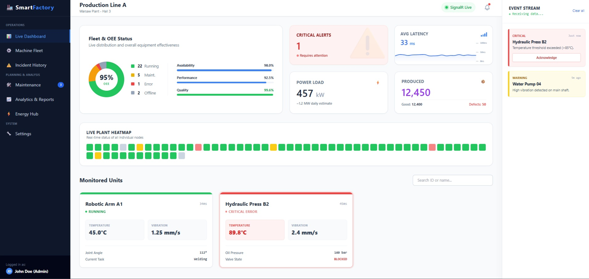
- **Production Lines** pokazuje kolejność maszyn, statusy i zależności na linii. Widok `/production` korzysta z API; dodatkowy `/production1` jest makietą V2 z danymi wpisanymi w kodzie. Część wskaźników i animacje mają charakter demonstracyjny.
  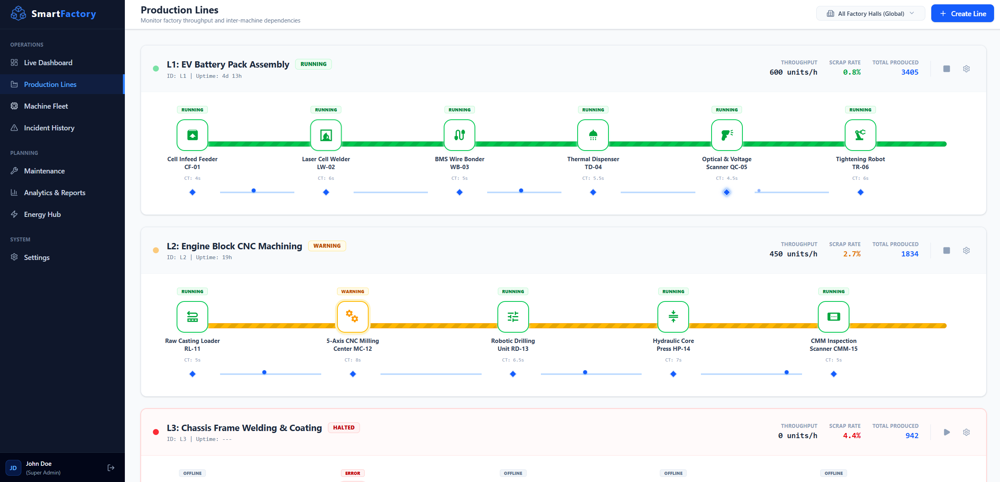
- **Machine Fleet** jest rejestrem urządzeń. Lista, szczegóły, formularze i zapis progów korzystają z API. W karcie maszyny wykres, historia incydentów i panel predykcji wymagają podłączenia lub implementacji.
  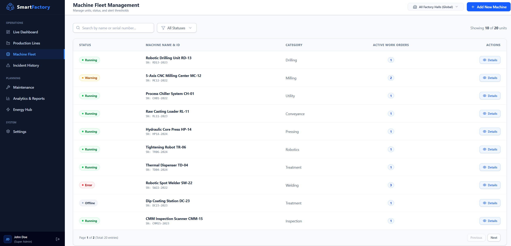
- **Incident History** ma odpowiadać na pytanie, co wydarzyło się z urządzeniem i kiedy. Istnieją modele, dane demonstracyjne i koncepcje ekranów; osobna strona React nie jest podłączona.
  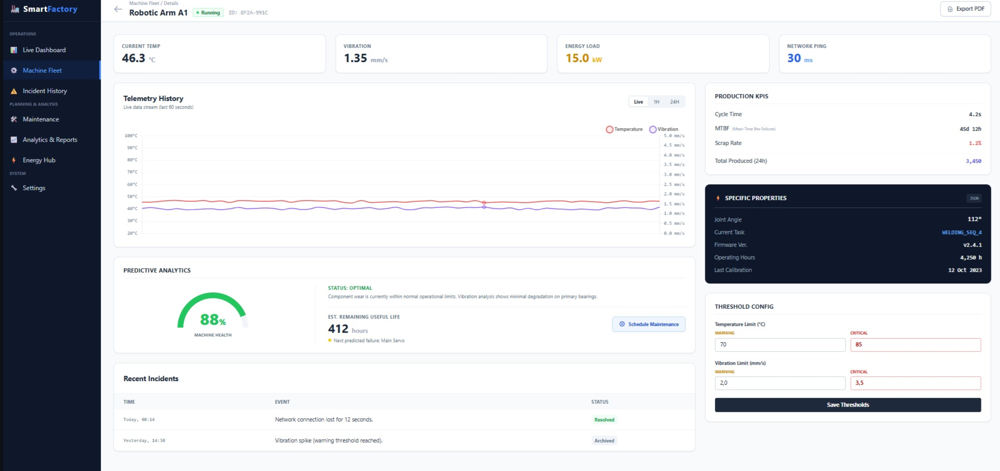
- **Maintenance** ma organizować pracę techników: zlecenia, terminy, osoby odpowiedzialne i weryfikację napraw. API zleceń istnieje, a tablica Kanban jest makietą. Statusy wymagają ujednolicenia.
- **Analytics & Reports** ma służyć ocenie przestojów i wyników produkcji, w tym OEE. Istnieją modele i makieta; poprawne raporty wymagają pełnych danych oraz obliczeń.
  
- **Energy Hub** ma analizować moc, energię i szacowane koszty. Obecnie jest makietą; pomiar mocy w kW trzeba dopiero przeliczać na energię w kWh z uwzględnieniem czasu.
  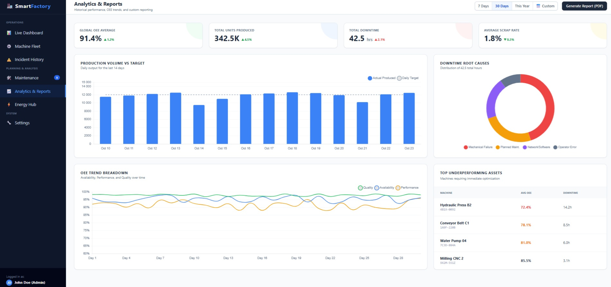
- **Settings** ma skupiać użytkowników, role, konfigurację hali, powiadomienia i przechowywanie danych. Część zaplecza istnieje, ale pełny panel i procesy obsługujące ustawienia pozostają do przygotowania.

**Co można pokazać w obecnym prototypie?** Logowanie, listę i kartę maszyny, edycję danych i progów, tworzenie linii oraz zmianę jej statusu. Start i stop aktualizują model w bazie, bez sterowania fizycznymi urządzeniami. Dane z API pochodzą z demonstracyjnej bazy. Wartości kondycji i czasu do awarii na karcie są statycznymi przykładami.

**Jak działa zaplecze i co rozwijamy dalej?** Frontend wykorzystuje React 19 i TypeScript, backend ASP.NET Core/.NET 8, a bazą jest SQL Server z Entity Framework Core. Komunikacja odbywa się przez REST i Axios. Kod symulatora oraz SignalR istnieje, lecz pełny strumień pomiarów nie jest podłączony. Kolejne kroki to spójny proces zleceń i dostęp do danych, ekrany napraw i incydentów, działający monitoring, raporty oraz pilotaż integracji z maszynami.

**Jak korzystać z dokumentu?** Dalsze sekcje omawiają każdą stronę, jej cel, obecny stan i potrzebne prace. Zawierają też **12 miejsc na screeny**, linki do makiet, opis architektury i endpointów. Podczas prezentacji oznaczamy ilustracje zgodnie z ich źródłem: prototyp React, makieta HTML albo koncepcja.

---

Smart Factory CMMS to rozwijana aplikacja internetowa do ewidencji maszyn i organizacji utrzymania ruchu. Docelowo ma połączyć informacje o urządzeniach, zgłoszenia awarii, zlecenia napraw i podgląd pracy linii produkcyjnych. Użytkownikami są administratorzy zakładu i hali, kierownicy utrzymania ruchu oraz technicy.

Ten dokument omawia wszystkie strony widoczne w bocznym menu. Dla każdej oddziela **rolę w docelowym produkcie** od **obecnego stanu implementacji**. Dane zapisane w bazie demonstracyjnej również są przykładowe — połączenie z API nie oznacza połączenia z rzeczywistą fabryką. Nie przedstawiamy statycznych makiet jako gotowych modułów.

## 1. Co daje aplikacja?

Pracownik może znaleźć urządzenie, sprawdzić jego miejsce na linii i przejść do szczegółów. W docelowym obiegu awaria tworzy incydent, kierownik przydziela zlecenie, a technik dokumentuje wykonane prace. Historia pozostaje przy maszynie i pomaga kolejnej zmianie.

Monitoring temperatury, wibracji i poboru mocy ma dostarczać informacji o stanie urządzenia. Raportowanie ma ułatwiać ocenę przestojów i wyników produkcji. Rozszerzenia te są rozwijane stopniowo; obecna wersja nie jest gotową usługą SaaS ani zweryfikowanym systemem predykcji awarii.

### Najważniejsze pojęcia

- **Utrzymanie ruchu, UR** — Działania utrzymujące maszyny w sprawności i organizujące ich naprawę

- **Hala, `FactoryHall`** — Obszar zakładu grupujący maszyny, linie i użytkowników

- **Linia, `ProductionLine`** — Grupa maszyn pracujących w określonej kolejności

- **Maszyna, `Machine`** — Urządzenie z identyfikatorem, parametrami i historią

- **Telemetria, `TelemetryRead`** — Pomiar z czasem wykonania i identyfikatorem urządzenia

- **Incydent, `Incident`** — Zarejestrowane zdarzenie, np. przekroczenie progu lub awaria

- **Zlecenie, `WorkOrder`** — Zadanie do wykonania, z osobą odpowiedzialną i statusem

- **Próg, `AlertThreshold`** — Wartość ostrzegawcza lub krytyczna dla konkretnej metryki

- **OEE** — Wskaźnik łączący dostępność, wydajność i jakość produkcji

## 2. Struktura aplikacji i nawigacja

Boczne menu dzieli produkt na trzy grupy: **Operations**, **Planning** i **System**. Poniższa kolejność odpowiada komponentowi `Sidebar.tsx`.

**Live Dashboard**

- **Grupa:** Operations
- **Obecna trasa React:** `/dashboard`
- **Stan:** Szkielet strony; rozbudowana makieta HTML

**Production Lines**

- **Grupa:** Operations
- **Obecna trasa React:** `/production`
- **Stan:** Widok połączony z API; część wskaźników demonstracyjna

**Machine Fleet**

- **Grupa:** Operations
- **Obecna trasa React:** `/machines`
- **Stan:** Lista i formularz połączone z API

**Incident History**

- **Grupa:** Operations
- **Obecna trasa React:** Brak; odnośnik `#`
- **Stan:** Modele danych i kilka koncepcji HTML

**Maintenance**

- **Grupa:** Planning
- **Obecna trasa React:** Brak; odnośnik `#`
- **Stan:** API zleceń oraz makieta tablicy

**Analytics & Reports**

- **Grupa:** Planning
- **Obecna trasa React:** Brak; odnośnik `#`
- **Stan:** Makieta i część modeli danych

**Energy Hub**

- **Grupa:** Planning
- **Obecna trasa React:** Brak; odnośnik `#`
- **Stan:** Makieta i model pomiaru mocy

**Settings**

- **Grupa:** System
- **Obecna trasa React:** Brak; odnośnik `#`
- **Stan:** Makieta, modele i część usług zaplecza

Dodatkowo istnieją `/login`, szczegóły `/machines/:id` i alternatywna makieta `/production1`. Po wejściu na `/` aplikacja przekierowuje do `/machines`. Makieta V2 nie jest osobną pozycją menu.

### Struktura zakładu

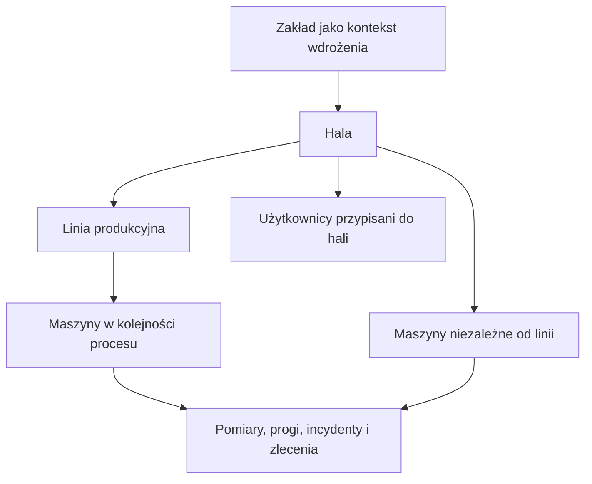

Maszyna należy do hali i może opcjonalnie należeć do linii. Kolejność na linii opisuje `OrderInLine`, a kolejność linii na hali — `OrderInHall`. W obecnym modelu nie ma osobnej encji organizacji klienta; hala nie jest odpowiednikiem izolowanego konta firmy w wielodostępnej usłudze.


## 3. Logowanie i role

**Trasa:** `/login`  
**Stan:** zaimplementowany ekran i zaplecze logowania.

Użytkownik podaje e-mail i hasło. Ekran pokazuje stan wysyłania oraz komunikat, jeśli logowanie się nie powiedzie. Po zalogowaniu wraca na żądaną stronę albo trafia do listy maszyn. Chronione trasy są opakowane w `ProtectedRoute`.

API wydaje token dostępu JWT. Frontend przechowuje go w pamięci i dołącza do zapytań. Token odnawiania sesji jest przesyłany w ciasteczku HttpOnly, a zaplecze obsługuje jego rotację. Użytkownik może wylogować się przyciskiem w stopce menu. Ekran zawiera również skróty do kont demonstracyjnych.

- **`SuperAdmin`** — Nadzór nad wszystkimi halami i dostęp do listy użytkowników

- **`HallAdmin`** — Zarządzanie urządzeniami i procesem UR w przypisanej hali

- **`Technician`** — Dostęp do urządzeń i realizacja zleceń w dozwolonym obszarze

Podział ról jest obecny, ale wszystkie operacje wymagają spójnego egzekwowania uprawnień. Część odczytów jest ograniczona do hali, a część endpointów wymaga dopracowania. Nie należy utożsamiać ukrycia przycisku z zabezpieczeniem API. Obecny ekran obsługuje logowanie istniejących kont; samoobsługowa rejestracja firmy pozostaje planem.

> **Miejsce na screen 01:** ekran logowania z formularzem, bez ujawniania haseł lub tokenów.

<!--  -->

**Materiały w kodzie:** `AuthPage.tsx`, `AuthContext.tsx`, `ProtectedRoute.tsx`, `apiClient.ts`, `AuthController.cs` i usługi tokenów.

## 4. Operations — Live Dashboard

**Nazwa polska:** panel bieżącego stanu zakładu  
**Trasa:** `/dashboard`  
**Stan:** komponent React wyświetla obecnie nagłówek; docelowy układ jest makietą HTML.

### Rola strony

Dashboard ma odpowiedzieć na pytanie: **co wymaga uwagi w tej chwili?** Kierownik nie musi otwierać każdej karty maszyny. Widzi podsumowanie urządzeń, alarmy oraz wybrane pomiary i może przejść do źródła problemu.

Makieta zakłada zestawienie statusów floty, wskaźniki produkcyjne, podgląd rozmieszczenia maszyn, karty monitorowanych urządzeń i strumień zdarzeń. OEE widoczne w koncepcji będzie dostępne dopiero po przygotowaniu poprawnych danych raportowych.

### Planowane działanie

1. Użytkownik wybiera halę lub, przy odpowiedniej roli, widok globalny.
2. Panel pokazuje aktualne statusy i czas ostatniej aktualizacji danych.
3. Wyróżnia maszyny wymagające uwagi, z powodem alarmu.
4. Kliknięcie urządzenia otwiera szczegóły; kliknięcie zdarzenia prowadzi do incydentu.

Przy braku połączenia panel powinien pokazać brak aktualnych danych. Sam napis „Live” nie wystarcza do potwierdzenia świeżości pomiaru.

### Stan techniczny

W projekcie istnieją `TelemetryHub`, `TelemetryChannel` i `FactorySimulatorService`, ale `Program.cs` nie rejestruje obecnie SignalR, kanału ani symulatora i nie mapuje huba. Frontend nie ma klienta SignalR ani subskrypcji `ReceiveTelemetry`. Dashboard nie odbiera więc w obecnej wersji strumienia danych.

Kod symulatora przewiduje zmiany temperatury, wibracji i poboru mocy oraz zmianę statusów. Jest narzędziem demonstracyjnym; nie jest zwalidowanym modelem fizycznym urządzeń.

> **Miejsce na screen 02:** docelowy dashboard. Używając istniejącego obrazu lub HTML, podpisz go jako makietę.

<!-- 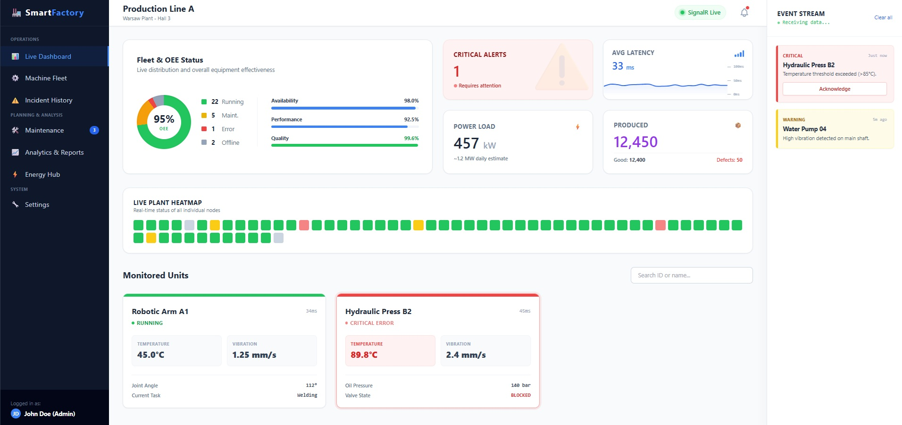 -->

**Makieta:** [dashboard/test2.html](media/mockups/dashboard/test2.html).  
**Do ukończenia:** pełny ekran, uruchomienie usług, zabezpieczenie strumienia według dostępu, obsługa rozłączenia, zapis pomiarów i aktualizacja kart.

## 5. Operations — Production Lines

**Nazwa polska:** linie produkcyjne  
**Trasa:** `/production`  
**Stan:** ekran połączony z API; wskaźniki mają różny stopień gotowości.

### Rola strony

Widok pokazuje zależności między maszynami. Awaria jednego stanowiska może wpływać na całą linię, a jej wolniejszy etap może ograniczać wydajność procesu. Kierownik widzi kolejność urządzeń i przechodzi bezpośrednio do wybranej maszyny.

### Co znajduje się na ekranie?

- Wybór hali w nagłówku; administrator globalny może przeglądać wszystkie hale.
- Lista kart linii z nazwą, kolejnością i statusem.
- Poziomy schemat maszyn, ich statusy, ikony i czasy cyklu.
- Animacja przepływu między stanowiskami.
- Podsumowanie przepustowości, liczby sztuk i odsetka braków.
- Formularz tworzenia linii oraz przyciski zatrzymania i uruchomienia jej statusu.

### Jak interpretować wskaźniki prototypu?

- **Status linii i maszyn** — Wartości pobrane z API i bazy demonstracyjnej

- **Throughput** — Teoretyczne `3600 / najdłuższy czas cyklu`; bez uwzględnienia wielu ograniczeń rzeczywistego procesu

- **Total Produced** — Licznik ostatniej maszyny na linii; nie raport produkcji za wybrany dzień

- **Scrap Rate** — Wartość demonstracyjna wyliczana ze statusu i licznika; nie pomiar braków jakościowych

- **Uptime** — Czas od zapisanej zmiany statusu, przy odpowiednim stanie linii

- **Animacja przepływu** — Wizualizacja oparta na czasie cyklu, nie sygnał rzeczywistego transportu części

### Start i stop

Zatrzymanie ustawia linię jako `Halted` i zmienia status pracujących maszyn na `Offline`. Uruchomienie sprawdza, czy linia ma maszyny i czy któraś nie ma statusu `Error` lub `Maintenance`; w takim przypadku zwraca odmowę. Przy dozwolonym uruchomieniu aktualizuje statusy w bazie.

Operacje te nie wysyłają komend do PLC ani innych urządzeń. Na prezentacji pokazujemy zmianę stanu modelu aplikacji. Docelowy CMMS będzie przede wszystkim dostarczał informacje i organizował prace serwisowe.

> **Miejsce na screen 03:** widok połączony z API, najlepiej karta linii pracującej i zatrzymanej.

<!--  -->

### Alternatywna makieta V2

**Trasa dodatkowa:** `/production1`. Komponent `ProductionLinesMockupV2.tsx` korzysta z wpisanej w kodzie tablicy przykładowych linii. Prezentuje wariant wyglądu, ikony maszyn i animacje przepływu. Nie pobiera danych z API; wartości i scenariusze są demonstracyjne.

> **Miejsce na screen 04:** makieta V2 — materiał do omówienia wyglądu i zależności na linii.

<!--  -->

**Materiały:** `ProductionLines.tsx`, `ProductionLineCard.tsx`, `AddProductionLineModal.tsx`, `ProductionLinesMockupV2.tsx` oraz [makieta HTML](media/mockups/production/production_lines.html).  
**Do rozwinięcia:** rzeczywiste dane produkcji w okresie, raport braków, aktualizacja stanów i dopracowanie zarządzania linią.

## 6. Operations — Machine Fleet

**Nazwa polska:** park maszynowy  
**Trasa:** `/machines`  
**Stan:** lista i formularze połączone z API.

### Rola strony

Machine Fleet jest punktem wejścia do ewidencji urządzeń. Użytkownik sprawdza stan maszyny, znajduje jej kartę i, mając odpowiednie uprawnienia, dodaje urządzenie. Jest to przydatne również wtedy, gdy zakład nie ma jeszcze monitoringu.

### Lista maszyn

Tabela pokazuje status, nazwę, numer seryjny, kategorię, liczbę aktywnych zleceń i przycisk przejścia do szczegółów. Dostępne są paginacja, filtr statusu i pole wyszukiwania. Lista zależy również od wybranej hali i kontekstu użytkownika.

Pole wyszukiwania sugeruje nazwę lub numer seryjny, lecz obecny backend wyszukuje **tylko po nazwie**. Wyszukiwanie po numerze seryjnym jest wymaganiem do uzupełnienia.

- **`Running`** — Pracuje

- **`Warning`** — Wymaga uwagi, np. ze względu na przekroczenie progu

- **`Error`** — Stan awarii

- **`Maintenance`** — Stan prac serwisowych

- **`Offline`** — Nie pracuje lub jest niedostępna; dokładny powód wymaga dodatkowych danych

Status `Offline` nie dowodzi sam w sobie utraty łączności — w prototypie może wynikać także z zatrzymania linii.

### Dodawanie i edycja

Formularz pozwala opisać urządzenie, wskazać jego halę i linię oraz ustawić parametry używane w modelu demonstracyjnym. API obsługuje również aktualizację i dezaktywację maszyny. Usunięcie przez API jest logiczne: rekord otrzymuje `IsActive = false`, dzięki czemu dane nie są od razu fizycznie usuwane z bazy.

W interfejsie są stany ładowania, błędu, pustej listy i potwierdzenia dodania. Widoczność przycisków oraz uprawnienia zaplecza wymagają dalszego ujednolicenia. Licznik aktywnych zleceń też wymaga wspólnej definicji zamkniętego statusu.

> **Miejsce na screen 05:** lista maszyn z filtrem i paginacją.

<!--  -->

> **Miejsce na screen 06:** formularz dodawania albo edycji urządzenia.

<!--  -->

**Materiały:** `MachineFleet.tsx`, `AddMachineModal.tsx`, `useMachines.ts`, `MachinesController.cs` i `MachineRepository.cs`.  
**Do dopracowania:** wyszukiwanie po numerze seryjnym, walidacja zgodności hali i linii, pełna kontrola modyfikacji według roli i obszaru.

### 6.1. Szczegóły maszyny

**Trasa:** `/machines/:id`  
**Stan:** połączenie z API dla danych urządzenia i progów; część paneli jest statyczna.

Karta maszyny ma skupiać identyfikację urządzenia, parametry, historię i konfigurację alarmów. Użytkownik przechodzi do niej z tabeli albo schematu linii.

- **Identyfikacja i status** — Dane urządzenia z API

- **Parametry statyczne** — Właściwości z zapisanego JSON, np. nominalna temperatura i moc

- **Production KPIs** — Kolejność na linii, licznik produkcji, czas cyklu i czas pracy; odsetek braków demonstracyjny

- **Edycja urządzenia** — Formularz połączony z aktualizacją API

- **Alert Thresholds** — Edycja i zapis progów temperatury oraz wibracji

- **Bieżące pomiary** — Pola temperatury, wibracji, mocy i opóźnienia pokazują obecnie `--`

- **Telemetry History** — Miejsce na wykres; brak podłączonego wykresu

- **Predictive Analytics** — Statyczne przykłady: 88% kondycji i 412 godzin; bez wyniku modelu

- **Recent Incidents** — Przykładowe wiersze wpisane w komponent, mimo dostępności modeli danych

- **Schedule Maintenance i eksport** — Elementy wymagające implementacji

Zaplecze udostępnia ostatnie pomiary i incydenty w danych szczegółów, ale obecny ekran nie wykorzystuje ich do pełnego dynamicznego widoku. Sam zapis progu w bazie nie uruchamia działającego alarmu, dopóki pomiary i reguły nie zostaną podłączone.

**Scenariusz do pokazania teraz:** otwarcie karty, odczyt danych urządzenia, edycja maszyny i zapis progów. **Scenariusz docelowy:** ocena świeżych pomiarów, analiza zdarzenia i utworzenie zlecenia.

> **Miejsce na screen 07:** aktualna karta React. Dla starego obrazu `machine_details.jpg` użyj podpisu „makieta”.

<!--  -->

**Materiały:** `MachineDetails.tsx`, `useMachineDetails.ts`, `useUpdateThresholds.ts` i [makieta szczegółów](media/mockups/lista%20maszyn/detale/detale5.html).

## 7. Operations — Incident History

**Nazwa polska:** historia incydentów  
**Trasa:** brak podłączonej strony React; menu ma odnośnik `#`.  
**Stan:** model i dane demonstracyjne w bazie, kilka makiet HTML; brak oddzielnego kontrolera incydentów.

### Rola strony

Incydent opisuje zdarzenie: co stało się z maszyną i kiedy. Historia ma pomagać w rozpoznawaniu powtarzających się usterek i ocenianiu czasu reakcji. Jest odrębna od zlecenia, które opisuje pracę do wykonania.

Przykład: „przekroczona temperatura frezarki” jest incydentem, a „sprawdź układ chłodzenia frezarki” — zleceniem. Model incydentu zawiera maszynę, czas, komunikat, ważność i status: `Active`, `Resolved` lub `Archived`.

### Docelowe funkcje

- Lista zdarzeń z filtrem hali, maszyny, okresu, ważności i statusu.
- Szczegóły incydentu oraz kontekst pomiaru, który wywołał alarm.
- Rozróżnienie aktywnych i zakończonych zdarzeń.
- Przejście do maszyny i powiązanego zlecenia.
- Ręczne zgłoszenie usterki i ograniczenie duplikatów alarmów.

W repozytorium znajduje się pięć wariantów UI: centrum alarmów, tablica triage, macierz hali, oś czasu oraz tabela z bocznym panelem szczegółów. To alternatywne koncepcje, a nie pięć działających modułów. Na prezentację warto wybrać jeden wariant; zwarta tabela jest dobrym punktem wyjścia do przeglądania historii.

> **Miejsce na screen 08:** wybrana koncepcja incydentów; podpisz nazwę wariantu.

<!--  -->

**Koncepcje:** [przegląd wariantów](media/mockups/incidents/index.html), [tabela i panel szczegółów](media/mockups/incidents/concept5_compact_data_grid.html).  
**Do ukończenia:** API i ekran, reguły powstawania zdarzeń, historia zmian oraz relacja incydent–zlecenie, której obecny model nie zapisuje bezpośrednio.

## 8. Planning — Maintenance

**Nazwa polska:** utrzymanie ruchu i zlecenia serwisowe  
**Trasa:** brak podłączonej strony React; menu ma odnośnik `#`.  
**Stan:** CRUD zleceń w API i makieta tablicy Kanban.

### Rola strony

Maintenance organizuje pracę zespołu. Kierownik tworzy zlecenie, wskazuje maszynę, termin i technika. Technik ma wiedzieć, co wykonać, i pozostawić informację o wyniku prac. Kierownik może następnie zweryfikować zakończenie.

Model `WorkOrder` zawiera numer zlecenia, tytuł, opis, maszynę, typ, status, przypisaną osobę oraz daty utworzenia, terminu i zakończenia. Typy opisane w modelu to `Routine`, `Predictive` i `Critical`. Etykieta `Predictive` opisuje kategorię pracy, nie potwierdza działania algorytmu predykcyjnego.

### Docelowy przebieg

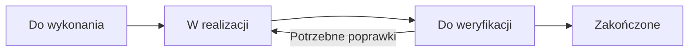

Makieta pokazuje kolumny, karty zleceń i informacje o przypisanych pracach. Plan obejmuje filtrowanie, zmianę statusu, komentarz z wykonanych czynności i historię. Harmonogram cyklicznych przeglądów jest rozszerzeniem — sam typ `Routine` nie uruchamia automatycznej prewencji.

### Co działa w zapleczu?

API obsługuje listę z paginacją i filtrami statusu oraz typu, odczyt szczegółów, utworzenie, aktualizację i usunięcie zlecenia. Nie ma jeszcze podłączonej tablicy React ani automatycznego tworzenia zlecenia z alarmu. Powiadomienia i kompletny proces odbioru prac wymagają implementacji.

W kodzie występują różne zestawy statusów: model opisuje `Open`, `InProgress`, `Review`, `Resolved`, tworzenie w repozytorium ustawia `To Do`, a liczniki maszyn traktują `Done` jako zamknięcie. Dlatego obecny licznik „aktywnych” prac nie jest jeszcze wiarygodną miarą procesu. Przed podłączeniem tablicy trzeba przyjąć jeden słownik, dozwolone przejścia i aktualizację czasu zakończenia.

> **Miejsce na screen 09:** tablica zleceń, obecnie jako makieta HTML.

<!-- 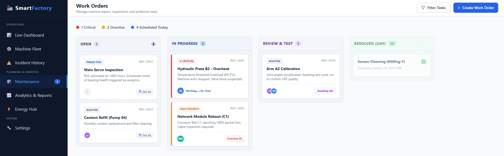 -->

**Makieta:** [maintance/maintance.html](media/mockups/maintance/maintance.html). Zachowano istniejącą pisownię katalogu i pliku.  
**Zaplecze:** `WorkOrdersController.cs`, `WorkOrderRepository.cs`, model i DTO zleceń.  
**Do ukończenia:** ekran, spójny workflow, historia prac, numeracja i walidacja, zakres dostępu techników oraz administratorów.

## 9. Planning — Analytics & Reports

**Nazwa polska:** analityka i raporty  
**Trasa:** brak podłączonej strony React; menu ma odnośnik `#`.  
**Stan:** makieta HTML, modele produkcji i demonstracyjne wpisy w bazie; brak gotowych obliczeń i modułu raportowego.

### Rola strony

Dashboard pokazuje bieżącą sytuację, natomiast raporty mają pomagać ocenić dłuższy okres. Kierownik porównuje zmiany i linie, szuka przyczyn przestojów oraz sprawdza, gdzie powstają straty.

Makieta przewiduje średnie OEE, produkcję względem planu, przyczyny przestojów, rozbicie trendu OEE i listę maszyn z gorszym wynikiem. Docelowo raport ma zawierać wskazany okres, zakres zakładu i informację o kompletności danych. Eksport PDF lub CSV jest planowaną funkcją.

### OEE i potrzebne dane

OEE oblicza się jako iloczyn trzech czynników:

```text
Dostępność A = czas pracy / planowany czas produkcji
Wydajność P = idealny czas cyklu × liczba wszystkich sztuk / czas pracy
Jakość Q = liczba dobrych sztuk / liczba wszystkich sztuk
OEE = A × P × Q
```

Definicje i wzory: [Vorne — obliczanie OEE](https://www.oee.com/calculating-oee/). Jednostki czasu muszą być zgodne, a okres i granica procesu jednoznacznie ustalone.

**Przykład dydaktyczny:** planowano 420 minut produkcji, maszyna pracowała 360 minut, idealny cykl wynosi 30 sekund, wykonano 600 sztuk, z czego 588 dobrych. Dostępność wynosi 85,71%, wydajność 83,33%, jakość 98%, a OEE **70%**. Ten wynik nie pochodzi z obecnej aplikacji.

Model `ProductionLog` zawiera dobre sztuki, braki, idealny i średni czas cyklu oraz aktywny czas pracy. `WorkShift` opisuje godziny zmiany. To podstawa danych, ale nie gotowy raport: trzeba ustalić planowany czas produkcji dla konkretnego dnia, przerwy wyłączone z planu, przestoje, zmiany przez północ, zmianę produktu i granicę liczenia sztuk na linii. Nie wolno sumować tej samej sztuki na każdym stanowisku jako osobnych wyrobów końcowych.

Planowane wskaźniki MTTR i MTBF wymagają dodatkowo wiarygodnego czasu początku awarii, przywrócenia sprawności i czasu pracy między awariami. Liczba zleceń albo ich termin nie wystarczy do ich poprawnego wyliczenia. Przy niepełnych danych raport powinien podać ograniczenie zamiast pozornego wyniku.

> **Miejsce na screen 10:** koncepcja raportów z wykresami; wartości demonstracyjne.

<!-- 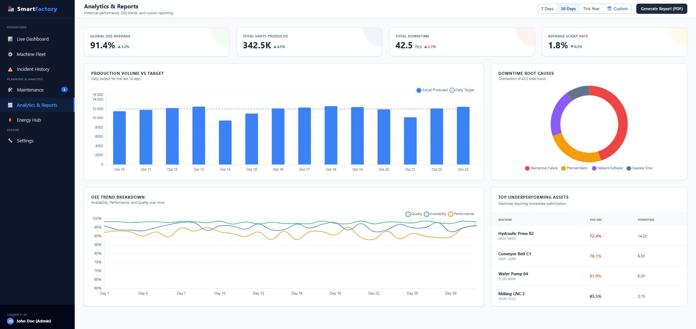 -->

**Makieta:** [dane analityczne/data.html](media/mockups/dane%20analityczne/data.html).  
**Do ukończenia:** kontrakt danych, agregacja i API raportów, obliczenia, filtry okresu, wykresy i eksport.

## 10. Planning — Energy Hub

**Nazwa polska:** analiza energii  
**Trasa:** brak podłączonej strony React; menu ma odnośnik `#`.  
**Stan:** makieta HTML i pole mocy w telemetrii, bez działającego modułu analizy energii.

### Rola strony

Energy Hub ma pokazać, które urządzenia pobierają najwięcej mocy, jak zmienia się obciążenie zakładu i ile energii zużywa produkcja. Może pomóc wskazać pracę urządzeń przy braku produkcji oraz okresy dużego obciążenia.

Makieta obejmuje krzywą zapotrzebowania na moc, ranking odbiorników, szacowany koszt, energię na sztukę oraz ostrzeżenie o przekroczeniu przyjętego limitu mocy. Wartości te są koncepcją raportowania.

### Moc a energia

`PowerLoadKw` to **moc w kW**, a nie zużyta energia. Energię w kWh szacuje się z mocy w czasie. Stałe obciążenie 10 kW przez 2 godziny odpowiada 20 kWh. Przy próbkach obliczenie musi uwzględnić odstępy między nimi, brakujące pomiary i metodę przybliżenia.

Koszt zależy od taryfy i składników rozliczenia. Energia na sztukę wymaga zgodnych okresów pomiaru energii i produkcji. Pole `Currency` lub limit mocy w `SystemSettings` nie jest kompletnym modelem taryfy. Makieta nie stanowi raportu z licznika ani pomiaru rozliczeniowego.

**Przykład docelowy:** kierownik zauważa duży pobór mocy po zakończeniu zmiany, otwiera ranking urządzeń i sprawdza, czy odbiorniki pomocnicze muszą nadal pracować. System dostarcza informację; decyzję operacyjną podejmuje zakład.

> **Miejsce na screen 11:** Energy Hub z wykresem mocy i rankingiem odbiorników.

<!-- 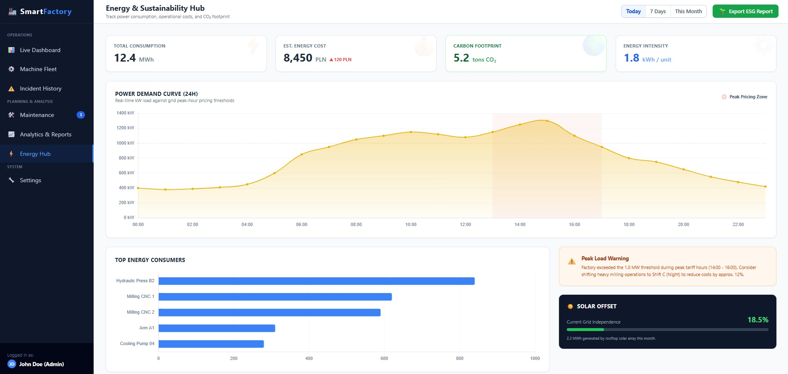 -->

**Makieta:** [energy hub/energy.html](media/mockups/energy%20hub/energy.html).  
**Do ukończenia:** źródło pomiarów, agregacja energii, taryfy, kontrola kompletności i API dla wykresów.

## 11. System — Settings

**Nazwa polska:** ustawienia systemu  
**Trasa:** brak podłączonej strony React; menu ma odnośnik `#`.  
**Stan:** makieta; modele ustawień i użytkowników, logowanie oraz częściowe API zaplecza.

### Rola strony

Ustawienia mają dopasować aplikację do zakładu i określić, kto może korzystać z danych. To również miejsce konfiguracji parametrów wspólnych, które wpływają na raportowanie i powiadomienia.

**Users & Roles**

- **Planowana funkcja:** Konta, role i przypisanie do hali
- **Stan zaplecza:** Modele, konta demonstracyjne, odczyt użytkowników dla SuperAdmin; brak pełnego panelu zarządzania

**Global Notifications**

- **Planowana funkcja:** Powiadomienia i raporty okresowe
- **Stan zaplecza:** Pola konfiguracji; brak implementacji wysyłki

**Data Retention**

- **Planowana funkcja:** Ustawienie czasu przechowywania pomiarów
- **Stan zaplecza:** Pole `RawTelemetryRetentionDays`; brak procesu egzekwowania retencji

**Factory Configuration**

- **Planowana funkcja:** Nazwa, strefa czasu, waluta, limit mocy i zmiany
- **Stan zaplecza:** Modele `SystemSettings` i `WorkShift`; brak pełnego API edycji

**Profile & Security**

- **Planowana funkcja:** Profil i zmiana hasła
- **Stan zaplecza:** Odczyt bieżącego użytkownika; pełny formularz i zmiana hasła wymagają implementacji

Istnienie `SlackWebhookUrl` lub `EnableEmailAlerts` nie oznacza, że wiadomości są wysyłane. Podobnie zapis liczby dni retencji nie usuwa jeszcze starych pomiarów. Każde ustawienie powinno mieć działający proces i ograniczony dostęp.

Przełącznik hali w obecnym nagłówku jest przeznaczony do wyboru zakresu przez SuperAdmin. Inne role pracują w kontekście przypisanej hali. Docelowo zasady te muszą być konsekwentne zarówno w interfejsie, jak i w API.

> **Miejsce na screen 12:** makieta ustawień z zarządzaniem użytkownikami lub konfiguracją zakładu.

<!--  -->

**Makieta:** [settings/settings.html](media/mockups/settings/settings.html).  
**Do ukończenia:** ekran, operacje zarządzania kontami i ustawieniami, uprawnienia, historia zmian, wysyłka powiadomień i wykonanie retencji.

## 12. Scenariusz łączący moduły

Docelowy przykład pokazuje pełny obieg pracy:

1. Kierownik otwiera **Live Dashboard** i widzi ostrzeżenie dla frezarki.
2. W **Production Lines** sprawdza miejsce urządzenia i wpływ na linię.
3. Otwiera szczegóły w **Machine Fleet** i porównuje pomiary z progami.
4. W **Incident History** sprawdza wcześniejsze podobne zdarzenia.
5. W **Maintenance** tworzy lub przegląda zlecenie i wskazuje technika.
6. Technik opisuje naprawę, a kierownik zatwierdza wykonanie prac.
7. W **Analytics & Reports** kierownik ocenia czas przestoju i wynik zmiany.
8. W **Energy Hub** sprawdza pobór energii w tym samym okresie.

To scenariusz zaplanowanego produktu. Obecny prototyp pozwala pokazać listę i szczegóły maszyn, zapis progów, tworzenie i widok linii oraz zmianę ich statusów. Pozostałe kroki przedstawiamy za pomocą makiet i wymagań.

## 13. Architektura i technologie

### 13.1. Stos wynikający z repozytorium

- **Frontend** — React 19, TypeScript, Vite, React Router

- **Interfejs** — Tailwind CSS, Lucide; w wybranych elementach MUI

- **Formularze i komunikacja** — React Hook Form, Axios, własne hooki i Context

- **Backend** — ASP.NET Core, .NET 8, C#

- **Dane** — SQL Server, Entity Framework Core, migracje Code First

- **API** — Kontrolery REST, DTO, AutoMapper, repozytoria i Dependency Injection

- **Uwierzytelnianie** — JWT, tokeny odnawiania, haszowanie haseł, role

- **Narzędzia zaplecza** — Swagger w trybie Development, Serilog

- **Planowany strumień danych** — SignalR oraz usługi telemetrii obecne w kodzie, wymagające integracji

Wersje odczytano z `ui/package.json` i `api/Api.csproj`. Nie przenoszono starszej informacji o React 18 z głównego README.

### 13.2. Obecny przepływ danych

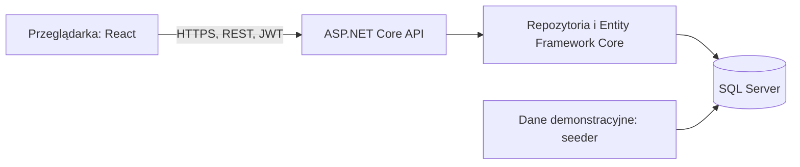

Frontend pobiera dane przez serwisy Axios i hooki. Kontekst uwierzytelniania przechowuje sesję, a kontekst fabryki — wybraną halę. Dane odświeżają się przy pobraniu lub ponownym wywołaniu po operacji; nie ma obecnie automatycznego strumienia SignalR w interfejsie.

Planowany osobny przepływ to **źródło pomiarów → przyjęcie i walidacja danych → zapis → reguły zdarzeń → aktualizacja UI**. Kod symulatora publikuje odczyt do kanału i huba, lecz nie znaleziono podłączonego konsumenta kanału zapisującego pomiary. Uruchomienie samego huba nie rozwiąże więc całego procesu telemetrii.

### 13.3. Główne grupy danych

- Struktura zakładu: `FactoryHall`, `ProductionLine`, `Machine`.
- Prace serwisowe: `Incident`, `WorkOrder`, `User`.
- Pomiary i progi: `TelemetryRead`, `AlertThreshold`.
- Produkcja: `Product`, `WorkShift`, `ProductionLog`.
- Konfiguracja i sesje: `SystemSettings`, `RefreshToken`.
- Planowana analityka predykcyjna: `MachinePrediction`.

Seeder wypełnia bazę przykładowymi urządzeniami, statusami, zleceniami, incydentami i historią danych. Są to dane przygotowane do demonstracji, a nie pomiary z fizycznych czujników.

### 13.4. Przykładowe endpointy obecnego API

- **Logowanie, odnowienie, wylogowanie** — `POST /api/auth/login`, `/api/auth/refresh`, `/api/auth/logout`

- **Bieżący użytkownik** — `GET /api/auth/me`

- **Lista maszyn** — `GET /api/machines`

- **Karta maszyny** — `GET /api/machines/{id}`

- **Dodanie, edycja, dezaktywacja** — `POST /api/machines`, `PUT` i `DELETE /api/machines/{id}`

- **Zapis progów** — `PUT /api/machines/{id}/tresholds`

- **Historia pomiarów** — `GET /api/machines/{id}/telemetry`

- **Hale** — `GET /api/factoryhalls`, `/api/factoryhalls/{id}`

- **Odczyt i tworzenie linii** — `GET` i `POST /api/productionlines`

- **Maszyny linii** — `GET /api/productionlines/{id}/machines`

- **Zmiana statusu linii** — `POST /api/productionlines/{id}/start` i `/halt`

- **Zlecenia** — `GET` i `POST /api/workorders`, `GET`, `PUT`, `DELETE /api/workorders/{id}`

- **Odczyt użytkowników** — `GET /api/users`, `/api/users/{id}` — dla SuperAdmin

Pisownia `tresholds` jest zgodna z obecną trasą w kodzie. Endpointy opisują implementację, nie gwarantują ukończenia całego procesu biznesowego ani jego testów w środowisku produkcyjnym.

## 14. Zakres dalszego rozwoju

**Etap 1 — Ujednolicenie statusów zleceń, walidacji i uprawnień do hali**

- **Uzasadnienie:** Wiarygodny proces oraz poprawny dostęp

**Etap 2 — Ekrany Maintenance i Incident History**

- **Uzasadnienie:** Podstawowy obieg napraw dla techników

**Etap 3 — Uruchomienie usług telemetrii, zapis i podłączenie klienta**

- **Uzasadnienie:** Działający monitoring demonstracyjny

**Etap 4 — Dashboard, aktualne pomiary i wykresy w karcie maszyny**

- **Uzasadnienie:** Czytelny bieżący stan z informacją o świeżości

**Etap 5 — Reguły alarmów, eliminacja duplikatów i powiązanie ze zleceniami**

- **Uzasadnienie:** Użyteczne zgłoszenia wymagające działania

**Etap 6 — Kompletność danych produkcyjnych i raporty**

- **Uzasadnienie:** Poprawne obliczenia dla ustalonego okresu

**Etap 7 — Jedna wybrana integracja przemysłowa i pilotaż**

- **Uzasadnienie:** Sprawdzenie wartości na rzeczywistych danych

**Etap 8 — Energia, dodatkowe integracje i badanie predykcji**

- **Uzasadnienie:** Rozwój oparty na potrzebach i dostępnych danych

Osobno przed oferowaniem usługi trzeba przygotować izolację klientów, wdrożenia, kopie i odtworzenie, monitoring oraz proces wsparcia. Plan przedsięwzięcia i podział na epiki opisuje [biznesplan](BIZNESPLAN.md).

## 15. Jak przedstawić projekt na zajęciach?

Zacznij od jednej naprawy, a następnie pokaż, jak poszczególne strony wspierają ten sam proces. Machine Fleet odpowiada „jakie mamy urządzenia?”, Production Lines — „jak są powiązane?”, Incident History — „co się wydarzyło?”, Maintenance — „kto ma wykonać pracę?”, a Analytics — „jaki był wynik?”. Settings określa zakres dostępu i konfigurację.

Do prezentacji obecnego stanu najlepiej wykorzystać logowanie, listę maszyn, kartę urządzenia i linię z API. Makieta V2 nadaje się do omówienia wariantu wyglądu. Dashboard, incydenty, tablicę napraw, raporty, energię i ustawienia przedstaw jako zaplanowane ekrany. Podczas pokazu nie opisuj statycznych wartości kondycji maszyny jako wyniku działającego modelu predykcyjnego.

Dokument przygotowano na podstawie aktualnego kodu i makiet. Nie wykonywano w ramach opracowania testu połączenia z fizycznymi maszynami ani uruchomienia pełnego scenariusza wdrożeniowego.
